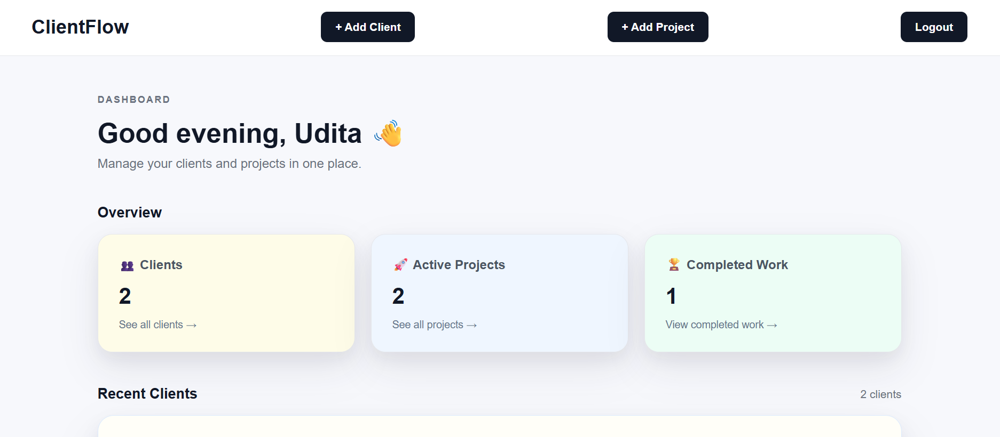
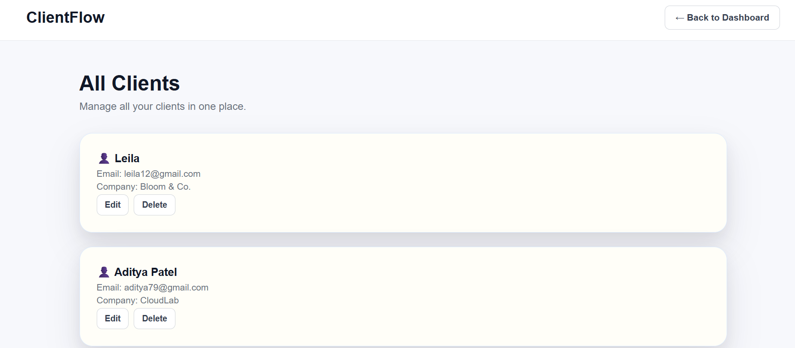
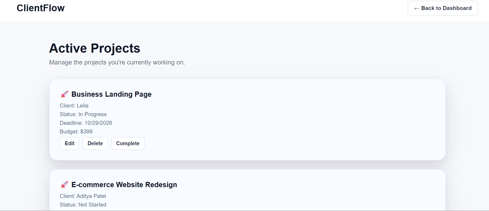
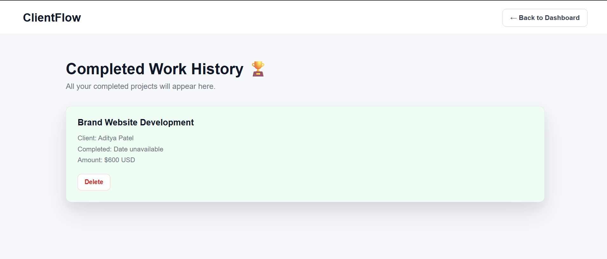

# 🚀 ClientFlow

### Less admin. More time for great client work.

ClientFlow is a full-stack CRM web application that helps freelancers manage their clients and projects in one place.

🔗 **[Live Demo](https://client-flow-woad.vercel.app)** · **[GitHub Repository](https://github.com/UditaMajumder/ClientFlow)**

---

## ✨ What can you do with ClientFlow?

- 👥 **Manage clients** — Create, view, update, and delete client records.
- 📁 **Track projects** — Organize projects and connect them with clients.
- 🔐 **Secure access** — Sign up and log in with JWT-based authentication.
- 📊 **View your dashboard** — Get a quick overview of clients and project progress.
- ☁️ **Access online** — Use the deployed application from your browser.

## 🛠️ Built With

| Frontend | Backend & Database |
|---|---|
| React, Vite, Axios | Node.js, Express.js, MongoDB |
| | JWT authentication |

## 🌐 Live Application

**[Open ClientFlow](https://client-flow-woad.vercel.app)**

Sign in or create an account to explore the dashboard and try the client and project management features.

## 💡 Why I Built It

I built ClientFlow to practise full-stack development by solving a practical problem: keeping client information and project work organized. Building it helped me work with REST APIs, database persistence, authentication, and deployment.

## 🚀 What's Next?

ClientFlow is a work in progress. Future improvements will focus on usability, better project tracking, and features that make it more useful for freelancers.

---

*Built with ☕, curiosity, and a lot of debugging by [Udita Majumder](https://github.com/UditaMajumder).*

---

## 📸 See ClientFlow in Action

### 📊 Dashboard

### 👥 Client Management

### 🚀 Project Management

### 🏆 Completed Work

